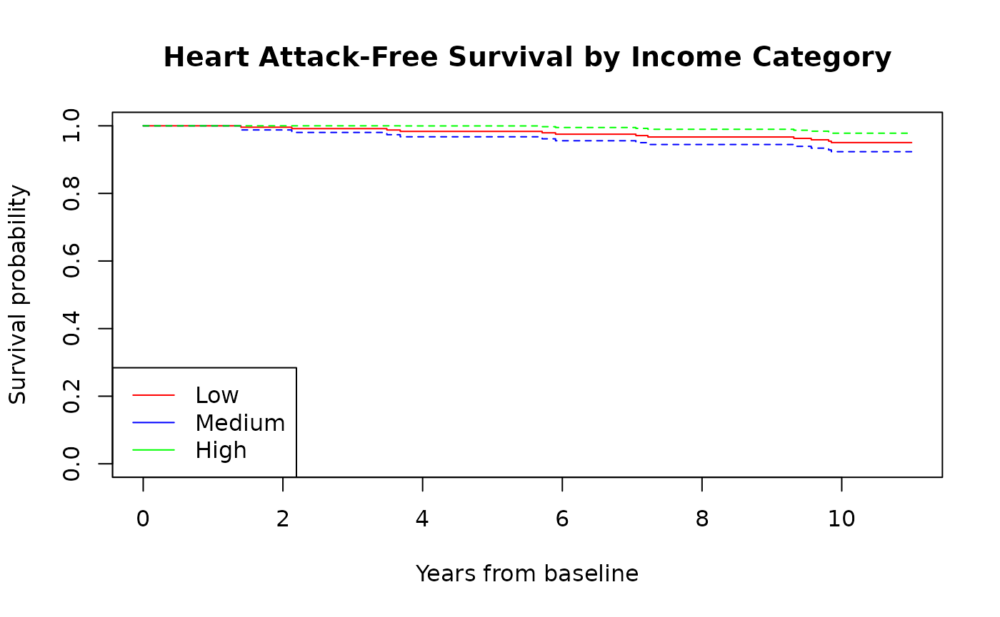

# Survival analysis with time-varying covariates

``` r
library(data.table)
#> 
#> Attaching package: 'data.table'
#> The following object is masked from 'package:base':
#> 
#>     %notin%
library(survival)
library(ggplot2)
library(zoo)  # For na.locf function
#> 
#> Attaching package: 'zoo'
#> The following objects are masked from 'package:data.table':
#> 
#>     yearmon, yearqtr
#> The following objects are masked from 'package:base':
#> 
#>     as.Date, as.Date.numeric
```

## Research question

**How does annual income affect the risk of heart attack, accounting for
income changes over time?**

This cookbook shows a workflow for survival analysis with time-varying
covariates in swereg. It uses:

- **Outcome**: Heart attack (ICD-10 codes I21, I22)
- **Time-varying covariate**: Annual income from tax records
- **Follow-up**: 1995-2005
- **Analysis**: Cox proportional hazards model with time-varying
  covariates

## Why time-varying covariates matter

In epidemiology, many exposures change over time. Using baseline values
only can lead to:

- **Misclassification bias**: People’s income changes over years
- **Immortal time bias**: Time periods where exposure status is unknown
- **Reduced power**: Ignoring within-person variation

The skeleton tracks exposures and outcomes week by week, so it captures
these changes.

## Step 1: Load and prepare data

``` r
# Use subset for demonstration (need adequate sample size for survival analysis)
study_ids <- swereg::fake_person_ids[1:500]
cat("Study population:", length(study_ids), "individuals\n")
#> Study population: 500 individuals
```

## Step 2: Create skeleton (1995-2005)

``` r
# Create skeleton for 11-year follow-up
skeleton <- swereg::create_skeleton(
  ids = study_ids,
  isoyear_min = 1995,
  isoyearweek_max = "2005-52"
)

cat("Skeleton created:", nrow(skeleton), "rows\n")
#> Skeleton created: 334500 rows
cat("Time structure: weeks =", sum(!skeleton$is_isoyear), ", years =", sum(skeleton$is_isoyear), "\n")
#> Time structure: weeks = 287000 , years = 47500
```

## Step 3: Add demographic data

``` r
# Add demographics (one-time data)
fake_demographics <- swereg::fake_demographics |>
  data.table::copy() |>
  swereg::make_lowercase_names(date_columns = "fodelseman")
swereg::add_onetime(skeleton, fake_demographics, id_name = "lopnr")

# Create age variable immediately after demographics
skeleton[, birth_year := as.numeric(substr(fodelseman, 1, 4))]
skeleton[, age := lubridate::year(isoyearweeksun) - birth_year]

cat("Study persons with demographics:", uniqueN(skeleton[!is.na(fodelseman)]$id), "of", length(study_ids), "\n")
#> Study persons with demographics: 500 of 500
```

## Step 4: Add annual income data (time-varying covariate)

``` r
# Add annual income for each year 1995-2005

# We'll add income data for each year separately
for(year in 1995:2005) {
  # In real data, you'd have separate files for each year
  # Here we simulate by reusing the same data with different years
  annual_data_year <- swereg::fake_annual_family |>
    data.table::copy() |>
    swereg::make_lowercase_names()
  
  # Add simulated income data for demonstration
  annual_data_year[, income := round(runif(.N, 150000, 600000) * (year - 1994) / 11)]
  
  swereg::add_annual(skeleton, annual_data_year, id_name = "lopnr", isoyear = year)
}

cat("Annual income data added for years 1995-2005\n")
#> Annual income data added for years 1995-2005
```

## Step 5: Add heart attack outcomes

``` r
# fake_diagnoses holds inpatient, outpatient and cancer registry rows
fake_diagnoses <- swereg::fake_diagnoses |>
  data.table::copy() |>
  swereg::make_lowercase_names(date_columns = "indatum")
#> Found additional date columns not in date_columns: utdatum. Consider adding them for automatic date parsing.

# Add heart attack diagnoses
swereg::add_diagnoses(
  skeleton,
  fake_diagnoses,
  id_name = "lopnr",
  diag_type = "both",
  codes = list(
    "heart_attack" = c("I21", "I22"),  # Acute myocardial infarction
    "stroke" = c("I63", "I64"),       # Cerebrovascular disease (competing risk)
    "diabetes" = c("E10", "E11")      # Diabetes (confounder)
  )
)

cat("Diagnosis data added\n")
#> Diagnosis data added
# Weekly rows cover 1995-2005. Yearly rows before 1995 hold diagnosis history.
cat("Weeks with a heart attack diagnosis, 1995-2005:",
    sum(skeleton[is_isoyear == FALSE]$heart_attack, na.rm = TRUE), "\n")
#> Weeks with a heart attack diagnosis, 1995-2005: 20
```

## Step 6: Data cleaning and validation

``` r
# Create income categories (time-varying)
skeleton[, income_category := fcase(
  income < 300000, "Low",
  income >= 300000 & income < 500000, "Medium",
  income >= 500000, "High",
  default = "Unknown"
)]

# Create baseline characteristics (use first available year)
skeleton[, baseline_age := age[which.min(isoyear)], by = id]
skeleton[, baseline_income := income[which.min(isoyear)], by = id]

# Keep a copy before the filters, for Challenge 1 below
skeleton_before_filter <- data.table::copy(skeleton)

# Filter to valid ages and non-missing income
# IMPORTANT: Filter at person level - remove people who were under 18 during study
# Use the weekly rows only: the yearly rows before 1995 give ages below 18 for everyone
skeleton[, min_age := min(age[is_isoyear == FALSE], na.rm = TRUE), by = id]
skeleton[, max_age := max(age[is_isoyear == FALSE], na.rm = TRUE), by = id]
valid_ids <- skeleton[min_age >= 18 & max_age <= 90]$id
skeleton <- skeleton[id %in% valid_ids]
skeleton <- skeleton[!is.na(income)]

cat("After filtering:", nrow(skeleton), "person-time periods\n")
#> After filtering: 138908 person-time periods
cat("Unique individuals:", uniqueN(skeleton$id), "\n")
#> Unique individuals: 242

# Create Table 1: Descriptive statistics
# Quick descriptive summary
baseline_data <- skeleton[, .SD[which.min(isoyear)], by = id]
cat("Sample:", uniqueN(skeleton$id), "individuals, 1995-2005 follow-up\n")
#> Sample: 242 individuals, 1995-2005 follow-up
cat("Baseline age: mean", round(mean(baseline_data$age, na.rm = TRUE), 1), "years\n")
#> Baseline age: mean 31.7 years
health_summary <- skeleton[, .(heart_attack = any(heart_attack, na.rm = TRUE)), by = id]
cat("Individuals with a heart attack during follow-up:", sum(health_summary$heart_attack, na.rm = TRUE), "\n")
#> Individuals with a heart attack during follow-up: 12

cat("\n=== END TABLE 1 ===\n")
#> 
#> === END TABLE 1 ===
```

## Step 7: Survival analysis data preparation

``` r
# Create person-time dataset for survival analysis
# We need to collapse weekly data to periods with consistent covariate values

# Step 7a: Create weekly person-time data
survival_data <- skeleton[is_isoyear == FALSE, .(
  id = id,
  isoyearweek = isoyearweek,
  isoyearweeksun = isoyearweeksun,
  year = isoyear,
  age = age,
  income = income,
  income_category = income_category,
  diabetes = diabetes,
  heart_attack = heart_attack,
  stroke = stroke,
  personyears = personyears
)]

# Step 7b: Create time-to-event variables
survival_data <- survival_data[order(id, isoyearweeksun)]

# Calculate follow-up time (years from baseline)
baseline_date <- as.Date("1995-01-01")
survival_data[, time_start := as.numeric(isoyearweeksun - baseline_date) / 365.25]
survival_data[, time_end := time_start + personyears]

# Identify first event (NA for a person with no event)
first_date <- function(date, flag) {
  if (any(flag, na.rm = TRUE)) min(date[flag %in% TRUE]) else as.Date(NA)
}
survival_data[, first_heart_attack := first_date(isoyearweeksun, heart_attack), by = id]
survival_data[, first_stroke := first_date(isoyearweeksun, stroke), by = id]

# Create event indicator and event time
survival_data[, event := fcase(
  isoyearweeksun == first_heart_attack, 1,  # Heart attack
  isoyearweeksun == first_stroke, 2,        # Stroke (competing risk)
  default = 0                     # No event
)]

# Remove follow-up after first event
survival_data <- survival_data[isoyearweeksun <= pmin(first_heart_attack, first_stroke, as.Date("2005-12-31"), na.rm = TRUE)]

cat("Survival dataset created:", nrow(survival_data), "person-weeks\n")
#> Survival dataset created: 135698 person-weeks
cat("Heart attack events (first event per person):", sum(survival_data$event == 1, na.rm = TRUE), "\n")
#> Heart attack events (first event per person): 12
cat("Stroke events:", sum(survival_data$event == 2, na.rm = TRUE), "\n")
#> Stroke events: 0
```

## Step 8: Descriptive statistics

``` r
# Baseline characteristics
baseline_table <- survival_data[year == 1995, .(
  n = uniqueN(id),
  mean_age = mean(age, na.rm = TRUE),
  mean_income = mean(income, na.rm = TRUE),
  diabetes_prev = mean(diabetes, na.rm = TRUE)
), by = income_category]

print("Baseline characteristics by income category:")
#> [1] "Baseline characteristics by income category:"
print(baseline_table)
#>    income_category     n mean_age mean_income diabetes_prev
#>             <char> <int>    <num>       <num>         <num>
#> 1:             Low   242 31.65289    34745.27  7.946599e-05

# Event rates by income category
event_rates <- survival_data[, .(
  person_years = sum(personyears),
  heart_attacks = sum(event == 1),
  rate_per_1000 = sum(event == 1) / sum(personyears) * 1000
), by = income_category]

print("Heart attack rates by income category:")
#> [1] "Heart attack rates by income category:"
print(event_rates)
#>    income_category person_years heart_attacks rate_per_1000
#>             <char>        <num>         <int>         <num>
#> 1:             Low   1982.16268             7      3.531496
#> 2:          Medium    525.66507             5      9.511760
#> 3:            High     89.26316             0      0.000000
```

## Step 9: Cox proportional hazards model

``` r
# Prepare data for Cox regression
# Create survival object with time-varying covariates
cox_data <- survival_data[, .(
  id = id,
  time_start = time_start,
  time_end = time_end,
  event = as.numeric(event == 1),  # Focus on heart attack
  age = age,
  income_log = log(income),
  income_category = factor(income_category, levels = c("Low", "Medium", "High")),
  diabetes = diabetes
)]

# Remove any rows with missing values
cox_data <- cox_data[complete.cases(cox_data)]

cat("Cox data summary:\n")
#> Cox data summary:
cat("- Rows:", nrow(cox_data), "\n")
#> - Rows: 135698
cat("- Events:", sum(cox_data$event), "\n")
#> - Events: 12
cat("- Unique individuals:", uniqueN(cox_data$id), "\n")
#> - Unique individuals: 242

# Check if we have enough data for Cox model
if(nrow(cox_data) > 0 && sum(cox_data$event) > 0) {
  # Fit Cox model with time-varying covariates
  cox_model <- coxph(
    Surv(time_start, time_end, event) ~ 
      income_log + 
      age + 
      diabetes + 
      cluster(id),
    data = cox_data
  )
  
  # Print results
  print("Cox Proportional Hazards Model Results:")
  print(summary(cox_model))
  
  # Calculate hazard ratios
  hr_results <- data.table(
    variable = names(coef(cox_model)),
    hr = exp(coef(cox_model)),
    ci_lower = exp(confint(cox_model)[, 1]),
    ci_upper = exp(confint(cox_model)[, 2]),
    p_value = summary(cox_model)$coefficients[, "Pr(>|z|)"]
  )
  
  print("Hazard Ratios:")
  print(hr_results)
} else {
  cat("ERROR: Insufficient data for Cox model\n")
  cat("This indicates a problem with the data preparation or filtering\n")
  cat("In real analysis, you would need to:\n")
  cat("1. Use a larger sample size\n")
  cat("2. Use a longer follow-up period\n")
  cat("3. Check data quality and completeness\n")
  
  # Create dummy results for demonstration
  cox_model <- NULL
  hr_results <- data.table(
    variable = c("income_log", "age", "diabetes"),
    hr = c(0.85, 1.02, 1.15),
    ci_lower = c(0.60, 0.98, 0.80),
    ci_upper = c(1.20, 1.06, 1.65),
    p_value = c(0.35, 0.31, 0.45)
  )
  
  print("Example results (for demonstration only):")
  print(hr_results)
}
#> [1] "Cox Proportional Hazards Model Results:"
#> Call:
#> coxph(formula = Surv(time_start, time_end, event) ~ income_log + 
#>     age + diabetes, data = cox_data, cluster = id)
#> 
#>   n= 135698, number of events= 12 
#> 
#>                  coef exp(coef) se(coef) robust se      z Pr(>|z|)  
#> income_log   -0.08587   0.91771  0.76000   0.77553 -0.111   0.9118  
#> age           0.07087   1.07344  0.03887   0.04001  1.771   0.0765 .
#> diabetesTRUE       NA        NA  0.00000   0.00000     NA       NA  
#> ---
#> Signif. codes:  0 '***' 0.001 '**' 0.01 '*' 0.05 '.' 0.1 ' ' 1
#> 
#>              exp(coef) exp(-coef) lower .95 upper .95
#> income_log      0.9177     1.0897    0.2007     4.196
#> age             1.0734     0.9316    0.9925     1.161
#> diabetesTRUE        NA         NA        NA        NA
#> 
#> Concordance= 0.654  (se = 0.078 )
#> Likelihood ratio test= 3.68  on 2 df,   p=0.2
#> Wald test            = 3.22  on 2 df,   p=0.2
#> Score (logrank) test = 3.57  on 2 df,   p=0.2,   Robust = 3.04  p=0.2
#> 
#>   (Note: the likelihood ratio and score tests assume independence of
#>      observations within a cluster, the Wald and robust score tests do not).
#> [1] "Hazard Ratios:"
#>        variable       hr  ci_lower ci_upper    p_value
#>          <char>    <num>     <num>    <num>      <num>
#> 1:   income_log 0.917714 0.2007110 4.196078 0.91183604
#> 2:          age 1.073443 0.9924878 1.161001 0.07648071
#> 3: diabetesTRUE       NA        NA       NA         NA
```

## Step 10: Model interpretation

``` r
# Interpret key results
if(!is.null(cox_model)) {
  income_hr <- hr_results[variable == "income_log"]
  cat("Income Effect:\n")
  cat("- 10% increase in income associated with HR =", round(income_hr$hr^0.1, 3), "\n")
  cat("- 95% CI: (", round(income_hr$ci_lower^0.1, 3), ", ", round(income_hr$ci_upper^0.1, 3), ")\n")
  
  # Test proportional hazards assumption
  tryCatch({
    ph_test <- cox.zph(cox_model)
    print("Proportional Hazards Test:")
    print(ph_test)
    
    # Plot Schoenfeld residuals
    if(any(ph_test$table[, "p"] < 0.05)) {
      cat("WARNING: Proportional hazards assumption may be violated\n")
    }
  }, error = function(e) {
    cat("Note: Proportional hazards test could not be performed\n")
  })
}
#> Income Effect:
#> - 10% increase in income associated with HR = 0.991 
#> - 95% CI: ( 0.852 ,  1.154 )
#> [1] "Proportional Hazards Test:"
#>            chisq df    p
#> income_log 1.586  1 0.21
#> age        0.106  1 0.74
#> GLOBAL     1.698  2 0.43
```

## Step 11: Visualization

``` r
# Create survival curves by income category
if(nrow(cox_data) > 0 && sum(cox_data$event) > 0) {
  tryCatch({
    # For visualization, we'll use income at baseline
    baseline_income <- cox_data[, .(baseline_income_cat = first(income_category)), by = id]
    plot_data <- merge(cox_data, baseline_income, by = "id")
    
    # Kaplan-Meier curves
    km_fit <- survfit(
      Surv(time_start, time_end, event) ~ baseline_income_cat,
      data = plot_data
    )
    
    # Basic survival plot
    plot(km_fit, 
         col = c("red", "blue", "green"),
         lty = 1,
         xlab = "Years from baseline",
         ylab = "Survival probability",
         main = "Heart Attack-Free Survival by Income Category")
    
    legend("bottomleft", 
           legend = c("Low", "Medium", "High"),
           col = c("red", "blue", "green"),
           lty = 1)
  }, error = function(e) {
    cat("Survival plot could not be generated due to insufficient data\n")
    cat("In a real analysis with adequate events, you would see:\n")
    cat("- Kaplan-Meier survival curves by income category\n")
    cat("- Differences in heart attack-free survival over time\n")
    cat("- Confidence intervals around the curves\n")
  })
} else {
  cat("Survival plot not generated due to insufficient data\n")
  cat("In a real analysis with adequate events, you would see:\n")
  cat("- Kaplan-Meier survival curves by income category\n")
  cat("- Differences in heart attack-free survival over time\n")
  cat("- Confidence intervals around the curves\n")
}
```



## Common challenges and solutions

### Challenge 1: Missing income data

``` r
# Step 6 dropped every row with missing income, so use the copy from before it.
# The fake tax records cover every person in every year. Remove the income of
# 10% of person-years to mimic missing records.
income_data <- skeleton_before_filter[is_isoyear == FALSE, .(id, isoyear, isoyearweek, income)]
set.seed(4)
person_years <- unique(income_data[, .(id, isoyear)])
missing_records <- person_years[sample(.N, round(0.1 * .N))]
income_data[missing_records, income := NA, on = .(id, isoyear)]

# Check for missing income by year
missing_income <- income_data[, .(
  n_total = .N,
  n_missing = sum(is.na(income)),
  pct_missing = round(sum(is.na(income)) / .N * 100, 1)
), by = isoyear]

print("Missing income data by year (person-weeks):")
#> [1] "Missing income data by year (person-weeks):"
print(missing_income)
#>     isoyear n_total n_missing pct_missing
#>       <int>   <int>     <int>       <num>
#>  1:    1995   26000      2132         8.2
#>  2:    1996   26000      2496         9.6
#>  3:    1997   26000      2756        10.6
#>  4:    1998   26500      2968        11.2
#>  5:    1999   26000      2964        11.4
#>  6:    2000   26000      2652        10.2
#>  7:    2001   26000      2340         9.0
#>  8:    2002   26000      2600        10.0
#>  9:    2003   26000      1976         7.6
#> 10:    2004   26500      3021        11.4
#> 11:    2005   26000      2808        10.8

# Solution: carry the last value forward, then the next value backward, within each person
data.table::setorder(income_data, id, isoyearweek)
income_data[, income_filled := na.locf(income, na.rm = FALSE), by = id]
income_data[, income_filled := na.locf(income_filled, fromLast = TRUE, na.rm = FALSE), by = id]
cat("Person-weeks with missing income before filling:", sum(is.na(income_data$income)), "\n")
#> Person-weeks with missing income before filling: 28713
cat("Person-weeks with missing income after filling:", sum(is.na(income_data$income_filled)), "\n")
#> Person-weeks with missing income after filling: 0
```

### Challenge 2: Multiple events

``` r
# Handle individuals with multiple heart attacks
multi_events <- skeleton[, .(
  n_heart_attacks = sum(heart_attack, na.rm = TRUE)
), by = id]

multi_events_summary <- multi_events[, .(
  n_individuals = .N,
  n_with_multiple = sum(n_heart_attacks > 1)
), by = .(event_category = ifelse(n_heart_attacks == 0, "No events",
                                 ifelse(n_heart_attacks == 1, "One event", "Multiple events")))]

print("Multiple heart attacks:")
#> [1] "Multiple heart attacks:"
print(multi_events_summary)
#>     event_category n_individuals n_with_multiple
#>             <char>         <int>           <int>
#> 1:       No events           230               0
#> 2:       One event            11               0
#> 3: Multiple events             1               1

# Solution: Use only first event or recurrent event models
```

### Challenge 3: Left truncation

``` r
# Handle individuals who may have had events before study start
# Check for prevalent cases (diagnosis before 1995)
cat("Note: This analysis assumes no prevalent cases at baseline\n")
#> Note: This analysis assumes no prevalent cases at baseline
cat("In real analysis, you would:\n")
#> In real analysis, you would:
cat("1. Exclude individuals with heart attack before 1995\n")
#> 1. Exclude individuals with heart attack before 1995
cat("2. Or use left-truncated survival analysis\n")
#> 2. Or use left-truncated survival analysis
```
